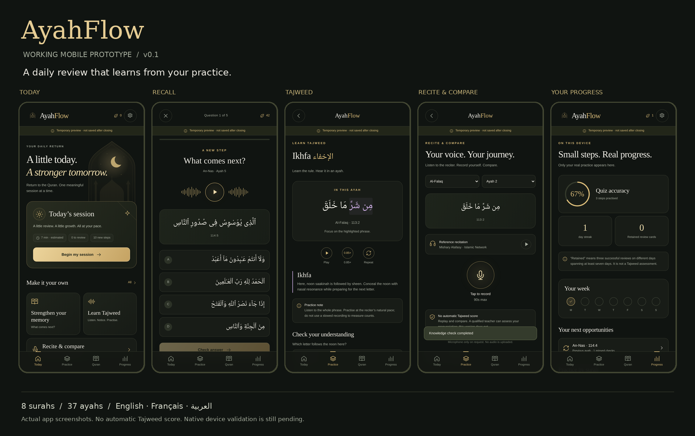

# AyahFlow

**Your daily return to the Quran.**



A local-first mobile app with a charcoal-and-gold interface: the whole Quran, daily adhkar, prayer times with a Salah tracker, and iOS widgets. Written in strict TypeScript with a small web runtime and a Capacitor 8 native adapter for iOS and Android.

**Status: v0.1, not an App Store / Google Play release.** What has and has not been verified, by kind of evidence:

| Evidence | Status |
| --- | --- |
| Automated tests | `npm run typecheck` and `npm test` (115 Node tests) pass |
| Native builds | iOS Debug build of the app and widget extension succeeds (Xcode 27) and is development-signed; Android not built in the latest round |
| Simulator | The app launches and renders Home; widgets not tested on the simulator |
| Real iPhone | Development build installed as an in-place update and launched; saved data (schema v13) kept |
| Not yet done | Widgets, notifications, counters and offline use checked by hand on the iPhone; any Android device; Release signing; TestFlight; store review |

Details and the open items: `docs/RELEASE-CHECKLIST.md`.

## Try the build

Open **`AyahFlow-preview.html`** in a current desktop browser. It contains the actual interface and learning logic, not a screenshot. No npm installation is needed for this preview.

Some attachment viewers block scripts or storage. Download the file and open it in a normal browser. If the app displays **“Temporary preview · not saved after closing”**, that browser has denied storage: progress and recordings remain only in the open page. They are not durable. This is deliberately visible, not a silent fallback.

For the included multi-file web build, using Node 22 or newer:

```bash
cd ayahflow
node scripts/serve.mjs
```

Open `http://localhost:4173`. The precompiled `www/` folder is included. This route is preferable for testing browser storage and microphone permissions. Real-phone audio should be tested in the native build or over HTTPS, not an unsecured LAN HTTP page.

## What is implemented

| Area | This build |
| --- | --- |
| Today | Adaptive session, 3/7/10-minute guides, due reviews, genuine practice points and calendar streaks |
| Memory | Next ayah, previous ayah, listen-and-identify the surah, hidden-text self-recall |
| Review engine | Per-mode cards, missed-answer priority, spaced intervals, stable question seeds, pause/resume, idempotent answer events |
| Quran library | All 114 surahs (Tanzil Uthmani, verbatim), search, juz filter, bookmarks, reading position, Pickthall's English translation, external tafsir links |
| Tajweed | Four draft lessons, highlighted source phrases, rule explanations, knowledge checks, reference playback controls |
| Voice practice | Record, stop, replay, explicitly save, delete with confirmation, and explicit export/share; 90-second clip limit |
| Progress | Quiz accuracy separated from self-assessed recall, missed-card practice, review retention criterion, chapter practice counts |
| Language/accessibility | English, French, Arabic RTL, reduced-motion option, labelled controls, responsive layout |
| Privacy | No account, ads, analytics SDK, application audio upload, or embedded secret keys; progress export/restore and delete controls |
| Native foundation | Capacitor configuration, native storage/share/notification/haptic adapters, permission helper, privacy-manifest draft, launcher icon assets |

**Tajweed lesson drafts:** Ikhfa, ghunnah on a doubled noon, qalqalah when stopping, natural madd. These are not a complete Tajweed curriculum. Qualified teacher review is pending and is labelled inside the app.

Arabic content has source references and structural tests. That is not a substitute for a qualified editorial review. See `docs/CONTENT-PROVENANCE.md`.

### Full Quran

All 114 surahs and 6236 ayahs from Tanzil (Uthmani 1.1, CC BY 3.0), verbatim and checksum-pinned, with search, a juz filter, the basmala as a heading, and every practice mode working across the whole text. See `docs/CONTENT-PROVENANCE.md`.

### Daily worship (schema v13)

Five tabs: **Home, Adhkar, Quran, Prayers, Progress.** Memorization practice, the four draft Tajweed lessons (still labelled as drafts) and the recitation studio are kept under **Quran → Memorization and practice**; nothing was removed and saved progress is migrated, not reset.

- **Home** is four compact widgets: the next prayer with a live countdown and the day's five prayers (with what you confirmed), today's prayer tracker (one tap confirms, "3 of 5"), one quick dhikr with a large tap target, and the **Ayah of the Moment** (a new whole ayah every local half hour, drawn from the ayahs that open a ruku' section, with Pickthall's translation, audio, save, copy and share; it stays put while you read it).
- **Salah tracker** (Prayers tab): statuses are *not confirmed*, *prayed*, *missed* and *made up*; only the user sets them, an unmarked prayer is never treated as missed, and a checkmark is a personal note, not a ruling on the prayer. History calendar, the last 7 days, full-day streak and 30-day figures. Optional check-in and tasbih reminders (off by default, at most one per prayer, ≤ 6 pending).
- **Guided tasbih after each prayer**: 33·33·33 + the tahlil (Muslim 597), with 33·33·34 (Muslim 596) and 10·10·10 (al-Bukhari 6329) as separate variants; it advances to the next phrase by itself and is saved per prayer and day.
- **Dhikr library**: 16 sourced adhkar (salawat, tahlil, tasbih, istighfar, Quranic and daily duas) with the hadith's own count or a clearly labelled personal goal, favourites, recently used, personal targets, daily and lifetime totals, copy/share, optional vibration and sound. Your own dhikr stays labelled as added by you and is never edited.
- **Short Recitations for Salah**: complete passages from longer surahs (e.g. 67:1–5, 55:1–13, 23:1–11, 59:21–24, 76:1–6), offered as suggestions only.
- **Widgets (iOS)**: the prayer widget shows the prayers you confirmed; the **Ayah of the Moment** widget works out the rotation itself from a verse pool bundled in the extension (`ios/App/AyahFlowWidget/AyahMoments.json`, generated from the corpus by `npm run build`), so it keeps going without the app being opened. Slots last 30 elapsed minutes and start on :00 and :30, also across daylight saving changes. WidgetKit decides when a widget actually redraws, so a change can show a little late. A widget too small for an ayah names it instead of cutting it. Between midnight and Fajr the tracker still shows the previous day, so a late Isha is noted on its own day. Widget data is shared through a keychain access group; a failed write is logged and shown on the Prayers page. **Widget appearance after the latest changes has not yet been checked on the phone.**

See `docs/CONTENT-PROVENANCE.md` for every source decision.

### Adhkar and smart reminders

The **Adhkar** tab has morning, evening, after-prayer, sleep and waking collections, and moments for leaving and entering home, riding, journeys and the mosque. Each text is quoted verbatim from a cited hadith (with grades and a sunnah.com link) or read from the Quran corpus; scholar review is pending. A repeat counter and an explicit "I recited it" are the only things recorded: a reminder is never counted as a recitation.

**Reminder sound:** adhkar notifications (timed and location/vehicle) play a short two-note chime generated by `scripts/make-chime.mjs` (`public/sounds/adhkar-chime.caf`, no third-party rights); iOS falls back to the default sound if it is missing. Before this, timed reminders on iOS were posted silently because no sound name was set.

**Dhikr counters** (Adhkar tab and Today): istighfar ×100 (Muslim 2702 / in-book 48/52), istighfar with tawbah "more than 70" (Bukhari 6307) and the after-prayer tasbih 33/33/33 plus the tahlil (Muslim in-book 5/188). Each phrase is sliced verbatim from a cited hadith, and the build checks that the count is stated in the cited narration. Counts are self-reported, saved per day on the device (schema v9, `setCount` sets rather than adds, so a repeated save cannot inflate it) and included in exports.

**Steps** (opt-in, iPhone and Android app only): read live from the phone's pedometer (iOS CMPedometer under Motion & Fitness; Android's step-counter sensor, labelled approximate because it has no history). The app stores only the on/off setting and the goal; step figures are never saved, exported or sent. **Not yet verified on a physical Android phone.**

**Automatic reminders** (iPhone and Android app, all off until you turn them on):

- *Places* — save Home, Work and your mosque from your current location (100–500 m). Leaving or arriving triggers the fitting dhikr; inside the morning or evening window the collection is grouped into the same notification.
- *Vehicle* — Android uses activity-recognition transitions (`IN_VEHICLE`). iPhone checks recent motion when the system wakes the app (significant location change or leaving Home), so it can be late or missed; an iOS Shortcuts automation (“When CarPlay connects → Open URL `ayahflow://moment/vehicle`”) is the dependable route.
- *Time* — morning after Fajr, evening after ‘Asr and a sleep reminder, from prayer times calculated on the device (adhan-js; method, Hanafi ‘Asr and window span are settings).

The rules engine (`src/adhkar.ts`) applies cooldowns, once-per-day collections, grouping and the user's choices; the native engines in `plugins/smart-reminders` (Swift and Java) follow the same steps while the app is closed. Saved places and detections stay on the device and are excluded from exports; no network request is made. **Not yet verified on physical devices** for real geofence crossings or vehicle trips; the OS can delay or drop background events.

### Athan

Five openly licensed recordings are bundled (Wikimedia Commons; credits and licences in the app and in `docs/THIRD-PARTY-NOTICES.md`), with a separate Fajr choice. Six well-known recordings from AlAdhan (Islamic Network) — three by Mishary Rashid Alafasy, Mansour Al-Zahrani, Hafiz Mustafa Özcan and Ahmad al-Nafees (Fajr) — can be streamed to preview and downloaded on request; they are not bundled. Users can also import their own recording. iOS plays a 28 s alert (44.1 kHz PCM; iOS caps notification sounds at 30 s); Android plays the full recording. None of the recordings has yet been checked by listening for this app.

### Voice following (experimental)

In the reader, **Follow my recitation** listens (after an explicit tap and a one-time consent) and highlights the ayah and word you are reciting, scrolling with you. Recognition runs fully on the device with [Tilawa](https://github.com/yazinsai/tilawa) (`@tilawa/core`, MIT) and ONNX Runtime Web. Audio is not stored or uploaded, and nothing is added to your progress. It follows your place only: it is not a pronunciation or Tajweed check and can be wrong.

The model is licensed **NPL-1.2** (no charge for the app or any feature it powers; see `docs/THIRD-PARTY-NOTICES.md`). It is not committed; fetch it before building:

```bash
npm run voice:fetch   # downloads ~75 MB into vendor/tilawa/ and verifies SHA-256
npm run build         # includes www/voice/ when the model is present
```

Builds without the model hide the feature. The single-file preview never includes it.

### Intentionally not claimed

There is **no automatic Tajweed or makhraj scoring**, transcript, phoneme assessment, AI teacher, or certification. Voice following only tracks your place. “Hidden-text recall” is the learner's own assessment. Multiple-choice success does not establish correct pronunciation or complete memorization.

Licensed offline recitation downloads, integrated tafsir, a mutashabihat curriculum, word-level audio alignment, child/family accounts, a teacher dashboard, cloud sync, subscriptions and social features are not implemented. Sharing a saved recording opens a share/export action; it does not deliver it to a connected teacher service.

## Develop

```bash
cd ayahflow
npm install
npm run typecheck
npm test
npm run dev
```

`npm install` needs internet. `package-lock.json` is committed; use `npm ci` for reproducible builds. A dependency audit has not been reviewed yet.

The web UI has no third-party runtime dependency. `npm run build` uses TypeScript to produce `www/` and regenerates the single-file preview. The native bridge is bundled separately by `npm run native:prepare` after dependencies are installed.

### iOS: first-time setup on a Mac

```bash
npm install
npm run ios:add
npm run ios
```

This creates the Xcode project with Capacitor, applies microphone metadata and starter icons, synchronizes the web build, and opens Xcode. Select your development team and a simulator or connected iPhone, then build/run in Xcode. Review `PrivacyInfo.xcprivacy` **target membership** and the privacy declarations before distribution.

Capacitor 8's documented environment requires Node 22+ and Xcode 26.0+. Check the current documentation before installing tooling: https://capacitorjs.com/docs/getting-started/environment-setup

### Android: first-time setup

```bash
npm install
npm run android:add
npm run android
```

This creates the Android Studio project, adds the microphone declaration and starter launcher/notification assets, synchronizes, and opens Android Studio. Choose a physical phone or emulator and run from the IDE. Capacitor 8 documents Android Studio 2025.2.1+ and an Android SDK installation.

Run `ios:add` / `android:add` only once per platform. Later, use:

```bash
npm run native:sync
npm run ios
# or
npm run android
```

`com.buildwithabdallah.ayahflow` is the configured development application ID, not a registered store listing. Confirm the application ID and product name before distribution. Launcher assets are installed once so later manual refinements are preserved. Native launch/splash appearance still requires review on devices.

### Native audio caveat

The recorder uses standard `getUserMedia` + `MediaRecorder` inside the WebView. Browser testing used a generated test stream. A real iPhone and Android device must confirm permission prompts, supported codecs, interruption handling, background transitions, Bluetooth routing, and playback. Unsupported devices show an error rather than a fabricated recording or score. See the release checklist for a potential native recording-adapter replacement if required by the supported device matrix.

## Privacy and audio

Progress uses browser localStorage, or native Preferences in the mobile adapter. Saved recordings use browser IndexedDB, or app-local Filesystem storage in the native adapter. Temporary previews use in-memory storage and display a warning. Nothing here guarantees recovery after uninstall, storage clearing, loss of a device, or operating-system cleanup.

The app does not upload recordings. Choosing **share** explicitly exports a clip through the browser or native share sheet. Device-level backups and the selected receiving app have their own policies. Native exported files temporarily exist in the app cache. “Delete all local data” removes the app's own progress and recordings; it cannot delete copies already shared or backed up elsewhere.

Reference recitation is **off by default**. Enabling it permits requests to Islamic Network's CDN, which receives the requester's IP address and the requested ayah. Audio is streamed on demand; it is not bundled or cached for offline redistribution. Live CDN access was not tested in the build container. The provider URL mapping was unit-tested.

Recitation rights remain with the relevant rights holders. Confirm commercial streaming, attribution, caching, and redistribution terms before release. The permissive nature of access is not a blanket commercial license. Sources: https://alquran.cloud/terms-and-conditions and https://alquran.cloud/api

## What the progress numbers mean

A next/previous/listen review records **quiz evidence**. Hidden-text recall records **self-assessed evidence**, excluded from quiz accuracy. Rule quizzes record lesson understanding, not pronunciation.

A review card is “retained” only after successful checks on at least three distinct local dates spanning at least seven days. This is an explicit product heuristic, not a validated probability of mastery. A miss clears the retained sequence and schedules a short review. Points reward participation, not religious merit.

See `docs/ARCHITECTURE.md` for the exact scheduler, failure behavior, and migration boundaries.

## Verification included

- **`npm test`: 115 Node tests pass** (`tests/*.test.mjs`): the corpus and translation checksums and verbatim text, the learning engine, migrations to schema v13, adhkar sources, the Salah tracker, prayer times for every method across DST and time-zone changes, the prayer day around midnight, high-latitude Isha, unique athan ids, the Ayah of the Moment across DST, and the widget's verse pool.
- **Strict TypeScript build passes** (`npm run typecheck`).
- **iOS:** Debug build for a physical iPhone succeeds; the development build is installed and launches (see `docs/RELEASE-CHECKLIST.md` for exactly what was and was not checked on the phone).
- **Original v0.1 delivery only:** 11 browser integration checks (`evidence/browser-tests.json`) with a synthetic microphone stream; not re-run since.

Unit and browser tests do not cover native behaviour, notifications, widgets on a device, live audio or store builds.

Evidence: `evidence/unit-tests.tap` (original delivery), `evidence/browser-tests.json`, `evidence/browser-tests.log`, and actual UI screenshots.

The optional UI test runner requires Python + Playwright and a Chromium installation. Its Chromium path is adjustable in `tests/ui-smoke.py`.

## Repository layout

```text
src/
  app.ts       Screens, navigation, user actions
  engine.ts    Pure learning model, scheduler, validation
  data.ts      Quran corpus access (Tanzil), surah metadata and draft lessons
  smart.ts     Prayer times, athan plan, reminders and widget data
  worship.ts   Ayah of the Moment, Salah tracker and progress
  i18n.ts      English / French / Arabic interface copy
  storage.ts   Web/native storage boundary and explicit temporary mode
  audio.ts     Recitation player and local recording lifecycle
  icons.ts     Original inline SVG interface artwork
public/        HTML, design system, manifest, original app icons
native/        Native bridge, privacy draft, launcher assets
scripts/       Web build, preview server, native bundle/configuration
www/           Included precompiled web build
tests/        Unit and browser tests
docs/         Architecture, provenance, roadmap, release gates
evidence/     Actual test results and screenshots
```

Read `AGENTS.md` before extending the app with a coding agent. Read `docs/RELEASE-CHECKLIST.md` before using this prototype with learners.
